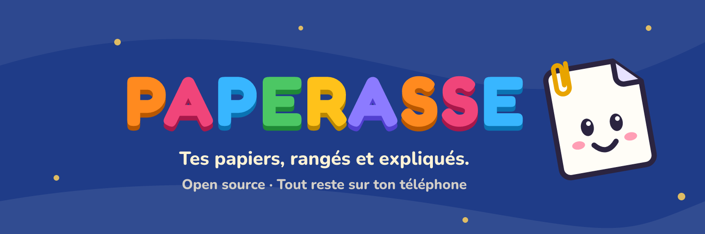

  

### Salut !

Je développe **[Paperasse](https://github.com/vortexturize-ai/paperasse)**, une app mobile gratuite et open source qui range et explique les papiers administratifs : courriers de la CAF, avis d'impôt, amendes, fiches de paie, contrats.

- **Tout reste sur le téléphone** : pas de compte, pas de serveur, ça marche hors connexion.
- **Elle explique** : ce que c'est, quoi faire, avant quelle date, en 4 langues, avec lecture à voix haute.
- **Elle protège** : coffre chiffré, code panique, sauvegarde chiffrée de bout en bout, détecteur d'arnaques.

  

**En ce moment** : publication sur Android, puis la version iPhone et de nouvelles langues.

**Avec** : React Native, Expo, TypeScript, SQLite chiffré (SQLCipher).

### Aider le projet

- Mettre une étoile à [Paperasse](https://github.com/vortexturize-ai/paperasse) et en parler autour de soi.
- Signaler un bug ou un papier mal compris, proposer une traduction : voir [comment contribuer](https://github.com/vortexturize-ai/paperasse/blob/main/CONTRIBUTING.md).
- Soutenir le développement sur Ko-fi :

