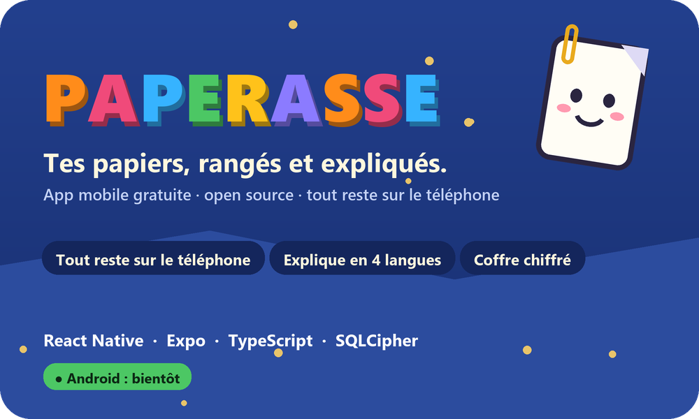
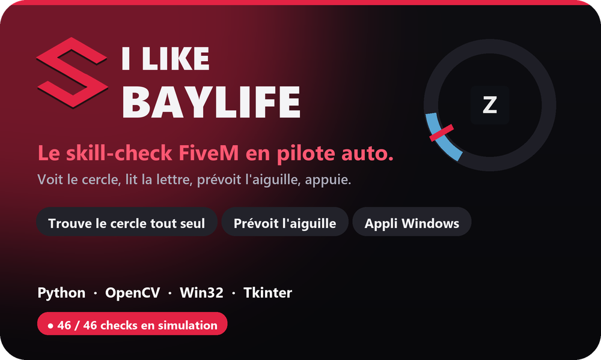

  

  

  
  
  
  

 

## ⚡ Mes projets

<table>
  <tr>
    <td width="50%" valign="top">
      
      
L'app mobile qui <b>range et explique</b> les papiers administratifs : CAF, impôts, amendes, fiches de paie, contrats. Ce que c'est, quoi faire, avant quelle date.

      

        
        
        
      

      <a href="https://github.com/vortexturize-ai/paperasse"><b>→ Voir Paperasse</b></a>
    </td>
    <td width="50%" valign="top">
      
      
L'appli Windows qui <b>joue le skill-check de FiveM toute seule</b> : elle voit le cercle, lit la lettre, prévoit l'aiguille et appuie pile dans la barre.

      

        
        
        
      

      <a href="https://github.com/vortexturize-ai/ILikeBaylife"><b>→ Voir I Like Baylife</b></a>
    </td>
  </tr>
</table>

 

## 📄 Paperasse
**Tes papiers, rangés et expliqués.** Une app mobile gratuite et open source.

- 🔒 **Tout reste sur le téléphone** : pas de compte, pas de serveur, ça marche hors connexion.
- 💬 **Elle explique** : ce que c'est, quoi faire, avant quelle date, en 4 langues, avec lecture à voix haute.
- 🛡️ **Elle protège** : coffre chiffré, code panique, sauvegarde chiffrée de bout en bout, détecteur d'arnaques.

  

> **En ce moment** : publication sur Android, puis la version iPhone et de nouvelles langues.
> **Avec** : React Native, Expo, TypeScript, SQLite chiffré (SQLCipher).

 

## 🎯 I Like Baylife
**Le skill-check FiveM en pilote auto.** Une appli dans la zone de notification de Windows, à côté de l'horloge.

<table>
  <tr>
    <td width="42%" align="center"></td>
    <td width="58%" valign="middle">
      
🎯 <b>Trouve le cercle tout seul</b> : un appui sur F7 et c'est réglé, au pixel près.

      
🔤 <b>Lit la lettre</b> affichée au centre, et apprend les nouvelles en te regardant jouer.

      
⏱️ <b>Prévoit l'aiguille</b> : vitesse mesurée en direct, appui calé dans la barre.

      
🟢 <b>Enchaîne jusqu'à 6 checks</b>, et compte les réussites quand la barre passe au vert.

      
🧪 <b>Simulation plein écran</b> pour s'entraîner sans le jeu.

    </td>
  </tr>
</table>

  
<b>🎬 Voir le moteur en diaporama</b>

   
  

    
  

 

## 🧰 Ma stack

  

 

## 🧭 Ma façon de faire

<table>
  <tr>
    <td width="33%" valign="top" align="center">
      <h3>🔒</h3>
      <b>Local d'abord</b> 
      Tes données restent sur ta machine. Pas de compte, pas de serveur à qui faire confiance.
    </td>
    <td width="33%" valign="top" align="center">
      <h3>🧡</h3>
      <b>Open source</b> 
      Tout le code est là, lisible, vérifiable. Tu peux voir exactement ce que fait l'app.
    </td>
    <td width="33%" valign="top" align="center">
      <h3>🎯</h3>
      <b>Utile avant tout</b> 
      Des outils qui règlent un vrai problème du quotidien, expliqués simplement.
    </td>
  </tr>
</table>

 

## 🤝 Aider

- ⭐ Mettre une étoile à [Paperasse](https://github.com/vortexturize-ai/paperasse) ou à [I Like Baylife](https://github.com/vortexturize-ai/ILikeBaylife), et en parler autour de soi.
- 🐛 Signaler un bug ou un papier mal compris, proposer une traduction : voir [comment contribuer à Paperasse](https://github.com/vortexturize-ai/paperasse/blob/main/CONTRIBUTING.md).
- ☕ Soutenir le développement de Paperasse sur Ko-fi :

  

  

