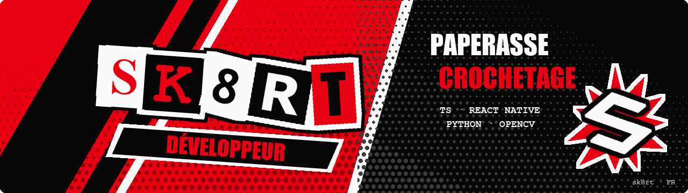
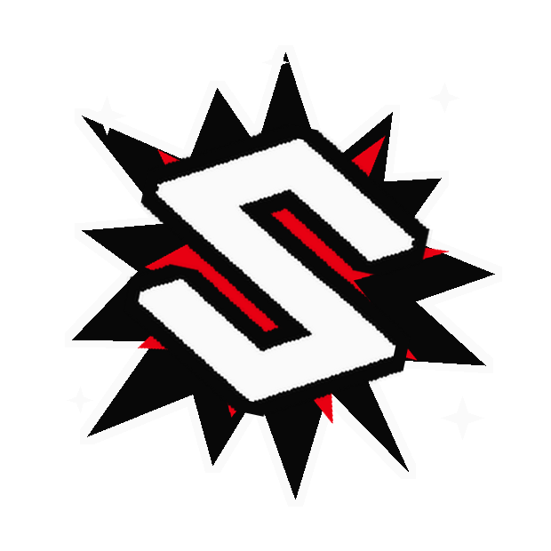
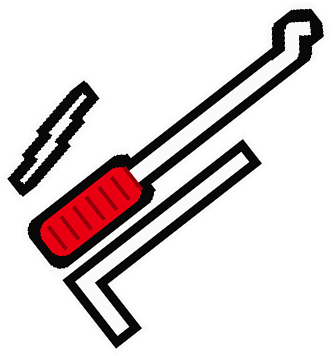
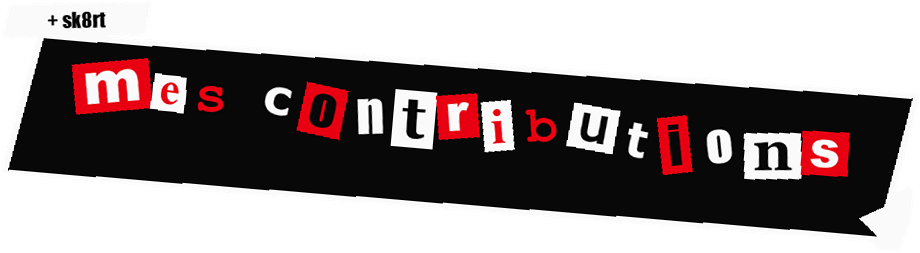
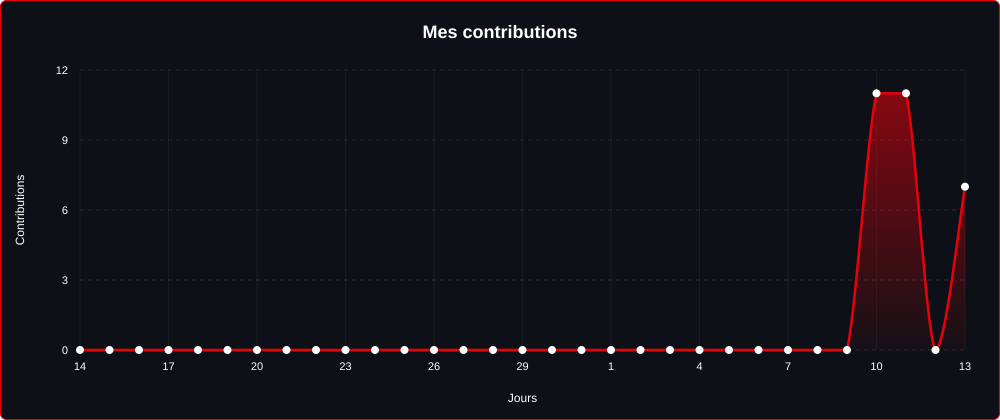
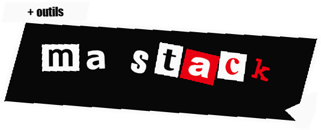
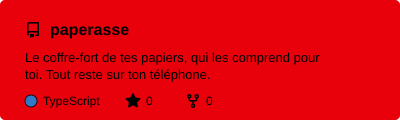
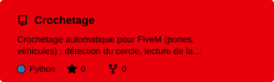

  

  
  
  

<h3 align="center">Qui suis-je ?</h3>

<b>sk8rt</b>, dev indé basé en France. Je code surtout en <code>TypeScript</code> et en <code>Python</code> : du <b>mobile</b> avec <code>React Native</code> / <code>Expo</code>, des <b>outils Windows</b> et de la <b>vision par ordinateur</b> avec <code>OpenCV</code>.

<b>Paperasse</b> : app mobile qui classe et explique les papiers administratifs (CAF, impôts, amendes, fiches de paie, contrats) : nature du document, démarche à faire, date limite. 4 langues, lecture à voix haute, coffre chiffré avec <code>SQLCipher</code>, sauvegarde chiffrée de bout en bout, détecteur d'arnaques. Stack : <code>React Native</code>, <code>Expo</code>, <code>TypeScript</code>. Sortie Android en cours, iOS ensuite.

<b>Crochetage</b> : bot Windows pour le mini-jeu de crochetage de FiveM. Capture <code>mss</code> d'une petite zone autour du cercle, détection du centre par <b>RANSAC</b> sur les traits de l'aiguille, lecture de la lettre par <b>template matching</b>, barre et aiguille en <b>HSV</b> sur l'anneau, appui anticipé selon la vitesse mesurée, envoi par <code>SendInput</code> en scancode. Journal JSONL de chaque check, simu <code>Tkinter</code> pour le calage : <b>221/221</b> checks au dernier run.

 

<b>Liens</b>

  
  
  

 

> [!CAUTION]
> Projets en développement actif : ça bouge souvent, et `main` peut casser.
>
> Issues et PR bienvenues.

 

  

  

<table>
  <tr>
    <td width="50%" align="center" valign="top">
      
        
      
    </td>
    <td width="50%" align="center" valign="top">
      
      
      
    </td>
  </tr>
</table>
